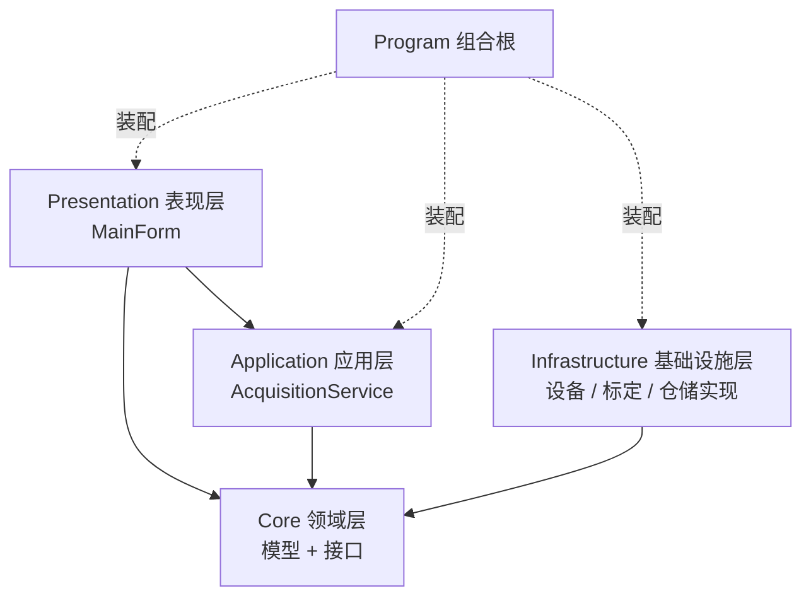

# 02 · 为什么需要分层

**目标**：能画出依赖方向图，能解释「为什么 `Core` 里不能出现 `using System.Windows.Forms`」，并知道每一层该放什么、不该放什么。

## 1. 从「一坨」到「四层」

原来的项目里，一个 `mainView.cs` 同时干了这些事：

- 打开串口、读寄存器（硬件）
- 做标定换算、判合格（业务规则）
- `Task.Run` 起后台线程（并发）
- `Invoke` 改 TextBox / 改灯颜色（UI）
- 组装 `dataModel` 并写 SQLite（持久化）
- 读 JSON 决定隐藏哪些列（配置）

**一个类知道得太多**，于是：换个 UI 框架要重写全部逻辑；想测一下标定公式必须开窗口；换数据库要翻遍所有页面找 SQL。

企业级做法不是"写更多代码"，而是**按变化原因切开**：会因为「界面改版」而变的代码放一起，会因为「换设备」而变的代码放一起，会因为「业务规则改」而变的代码放一起。



关键规则：**箭头只指向 Core，绝不反向**。Core 不知道谁在用它；Infrastructure 不知道页面存在；Application 不知道界面是 WinForms 还是 WPF。

## 2. 每层放什么

| 层 | 目录 | 允许依赖 | 放什么 | 绝对不能放 |
|---|---|---|---|---|
| Core | `Core/` | 只有 BCL | 实体/值对象、接口、配置模型 | 任何 UI 类型、任何具体数据库/设备 API、全局变量 |
| Application | `Application/` | Core + 宿主抽象 | 用例编排、后台服务、事件发布 | `Form`、`Window`、SQL、串口 |
| Infrastructure | `Infrastructure/` | Core + 第三方库 | 接口的具体实现（NModbus、SQLite、JSON…） | 业务规则、UI |
| Presentation | `Presentation/` | Application + Core | 控件、绑定、事件订阅、线程封送 | 硬件访问、标定公式、持久化 |

📌 **依赖倒置原则（DIP）**：`Application` 需要读设备，但它不 `new SimulatedModbusClient()`，而是依赖 `IModbusClient` 接口；具体实现由组合根在运行时"注入"。于是**高层不依赖低层，两者都依赖抽象**。

## 3. 用一条命令检验分层是否被破坏

```bash
grep -R "System.Windows.Forms" --include=*.cs .
```

只应该命中 `Program.cs` 和 `Presentation/MainForm.cs`。如果 `Application/AcquisitionService.cs` 里出现了 `Form`、`Control`、`Invoke`，说明分层已经被污染了。

再试：

```bash
grep -R "EnterpriseDemo.Infrastructure" --include=*.cs Core Application Presentation
```

应该**没有任何输出**——除了组合根，谁都不该知道具体实现类。这正是「换实现只改一行」的前提。

## 4. 分层带来的三个可验证收益

1. **可替换**：换 UI 框架不动业务层（下一套 WPF 会证明）。
2. **可测试**：`--self-test` 不开窗口就能验证配置、DI、标定。
3. **可并行**：做设备的人只改 `Infrastructure/SimulatedModbusClient.cs`，做界面的人只改 `Presentation/`，不会互相覆盖。

## 5. 与旧项目的逐条对照

| 旧项目 | 问题 | 本骨架 |
|---|---|---|
| `mainCommon.data[8]` 静态数组 | 谁都能改，多线程竞争，无变更通知 | `ChannelReading` 不可变记录，逐批发布 |
| 页面里 `new ModbusRtuClient()` | 页面绑死具体设备 | `IModbusClient` 注入 |
| `yuzhiModel.jisuan()` 混在模型里且到处调用 | 业务规则散落 | `ICalibrationService` 单一职责 |
| `SqlHelper.Insert` 在按钮事件里 | UI 直接碰数据库 | 仓储接口 + 应用层 |
| 配置分散在 `yuzhi.json`/`wayJson.json`/代码 | 硬编码 8、缺失即崩 | 单一 `appsettings.json` + 启动校验 |

📌 **注意**：分层不是越多越好。这个项目一共 9 个 `.cs` 文件，刻意保持精简。真实项目可以按业务再加「Domain Service」「DTO」「Mapper」，但**依赖方向不变**。

## 🧪 动手实验

**实验 2.1 · 破坏分层，看编译器怎么说（做完还原）**
在 `Core/Models.cs` 顶部临时加 `using System.Windows.Forms;`，`dotnet build`。你会发现 Core 项目里其实也能编过（因为整个项目引用了 WinForms）——这说明**编译器不会替你守分层**，得靠约定、代码审查或把 Core 拆成独立类库项目（第 10 章会做）。改完记得删掉。

**实验 2.2 · 画依赖图**
不看书，在纸上画出四层 + 组合根，标出 6 条依赖箭头。然后对照本章第 1 节的图自查。

**实验 2.3 · 找违规**
在 `Presentation/MainForm.cs` 里搜索 `Calibration`、`Convert`、`RawLow`。应该一个都没有。如果有，说明业务规则漏到了 UI。

## 自测

1. `Core` 里能不能放 `ILogger`？为什么本骨架的接口里没有日志参数？
2. `AcquisitionService` 属于哪一层？它为什么可以引用 `Microsoft.Extensions.Hosting` 却不能引用 `Form`？
3. 组合根算不算第五层？

<details><summary>答案要点</summary>

1. 不建议。`ILogger` 来自基础设施抽象，放进 Core 会让领域层依赖第三方；日志属于横切关注点，放在实现/应用层的构造函数里即可。
2. Application 层；`BackgroundService` 是宿主抽象（生命周期管理），不是 UI 框架，所以允许；`Form` 是表现层具体类型，会让它无法被 WPF 复用。
3. 不算「层」，它是启动时的装配代码，依赖所有层但不属于任何一层的业务职责；它也是唯一允许"知道一切"的地方。

</details>

---

上一章：[01-先跑起来](01-先跑起来.md) ｜ 下一章：[03-组合根与依赖注入](03-组合根与依赖注入.md)
