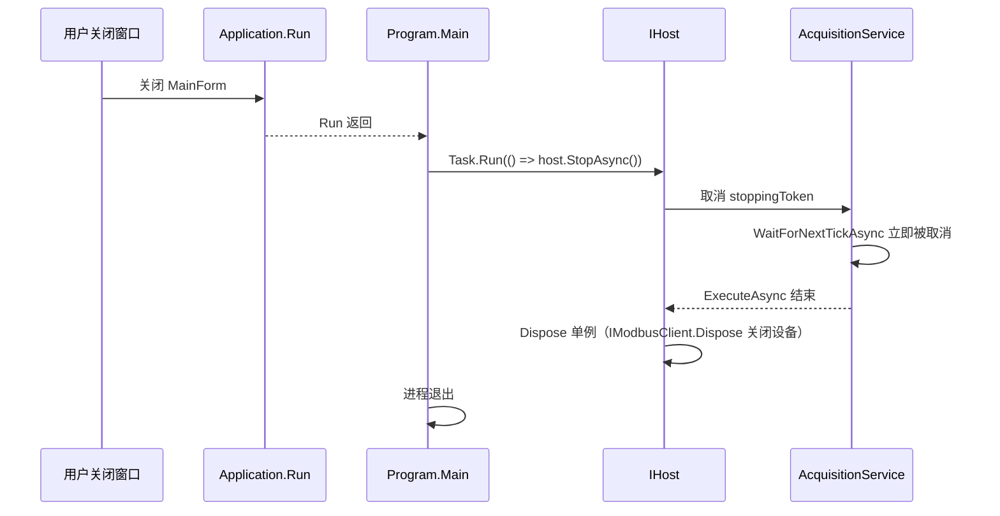

# 06 · 后台服务与取消令牌

**目标**：理解 `BackgroundService` 的生命周期，能解释「关闭窗口时采集循环如何干净地停下」。

## 1. 旧写法的问题

原项目的采集循环：

```csharp
private CancellationTokenSource readCTS = new();
readTask = Task.Run(async () => {
    while (!readCTS.Token.IsCancellationRequested) {
        try {
            if (IsConnected) { /* 读 + 换算 + Invoke */ }
            if (!IsConnected) { Connect(uiComboBox1.Text); }   // 后台读 UI 控件
            await Task.Delay(1000);
        } catch (Exception ex) { /* 空的 */ }
    }
});
```

问题清单：

- `readCTS.Cancel()` **从未被调用**，任务一直活到进程退出；
- `Task.Delay(1000)` 没传 token，取消后最多还要等 1 秒；
- 未连接时每秒无条件重试，空 COM 名也试；
- 后台线程读 `uiComboBox1.Text`（跨线程访问 UI）；
- 异常被空 catch 吞掉；
- 另一套 `timer1_Tick` 与之重复但从未启动（死代码）。

## 2. 企业级写法：`BackgroundService`

```csharp
// Application/AcquisitionService.cs
public sealed class AcquisitionService : BackgroundService
{
    protected override async Task ExecuteAsync(CancellationToken stoppingToken)
    {
        try
        {
            await _client.ConnectAsync(stoppingToken);
            using var timer = new PeriodicTimer(_interval);

            while (await timer.WaitForNextTickAsync(stoppingToken))
            {
                try
                {
                    var rawValues = await _client.ReadChannelsAsync(stoppingToken);
                    ... 换算 / 判定 / 打包 ...
                    BatchArrived?.Invoke(batch);
                }
                catch (OperationCanceledException) when (stoppingToken.IsCancellationRequested)
                {
                    break;                       // 正常关闭，不是错误
                }
                catch (Exception ex)
                {
                    _logger.LogError(ex, "本周期采集失败，将在 {Interval} 后重试", _interval);
                }
            }
        }
        catch (OperationCanceledException) when (stoppingToken.IsCancellationRequested) { }
        catch (Exception ex) { _logger.LogError(ex, "采集服务启动失败"); }
        finally { _logger.LogInformation("采集服务已停止"); }
    }
}
```

逐点对照：

| 机制 | 作用 |
|---|---|
| `BackgroundService` | 由 Generic Host 在 `host.Start()` 时调用 `StartAsync`，`host.StopAsync()` 时取消并等待 `ExecuteAsync` 结束 |
| `stoppingToken` | Host 提供的取消令牌，贯穿连接、读取、等待 |
| `PeriodicTimer` | .NET 6+ 的异步定时器，`WaitForNextTickAsync(token)` 取消时立即返回；不会像 `Task.Delay` 那样积累漂移 |
| `catch (OperationCanceledException) when (...)` | 用异常过滤器区分「正常取消」和「真实故障」 |
| 内层 catch 记录后继续 | 单次通信抖动不会终止整个服务 |
| `finally` 日志 | 关闭过程可观测 |

📌 **`CancellationToken` 是协作式取消**：它不会强行杀线程，而是把"请停止"的信号层层传递下去。所以每一层（Connect / Read / Timer）都要把 token 传进去，否则取消就失效。

📌 **为什么 `await Task.Delay(1000)` 换成了 `PeriodicTimer`**：`Delay` 是「执行完再等 1 秒」，周期 = 执行耗时 + 1 秒，会漂移；`PeriodicTimer` 是固定节拍，且单次等待可取消。

## 3. 关闭链路



`Task.Run` 包住 `StopAsync` 是为了避开 UI 线程的 `SynchronizationContext` 死锁（第 03 章已讲）。WPF 版本用同样的方式。

## 4. 服务层为什么不碰 UI

`AcquisitionService` 里没有 `Form`、没有 `Control`、没有 `Invoke`，只有一行 `BatchArrived?.Invoke(batch)`。

- 服务不知道谁在听、有几个订阅者、订阅者在哪个线程；
- 表现层自己决定怎么把数据送到 UI 线程（下一章）；
- 因此这个文件的**逐字节副本**可以直接给 WPF 用。

📌 **事件 vs 回调**：这里用 `event Action<...>`，简单够用。更大规模的项目会用 `IProgress<T>`、`Channel<T>` 或消息总线（MediatR / ReactiveUI），但原则不变：**生产者和消费者解耦，线程语义由消费者负责**。

## 🧪 动手实验

**实验 6.1 · 观察优雅停止**
把 `SampleIntervalMs` 改成 `5000`，运行，等界面刷新一次后立刻关闭窗口。若窗口能**立刻**关闭（不卡 5 秒），说明 token 传到了 `WaitForNextTickAsync`。再把 `WaitForNextTickAsync(stoppingToken)` 临时改成 `WaitForNextTickAsync()`（不传 token），重复实验，观察关闭是否变慢。做完还原。

**实验 6.2 · 单次故障不中断服务**
在 `SimulatedModbusClient.ReadChannelsAsync` 开头临时加：

```csharp
if (_random.NextDouble() < 0.2) throw new IOException("模拟串口超时");
```

运行 30 秒，观察输出窗口：应该出现 `LogError` 但界面继续刷新。这验证了"记录 + 继续"的降级策略。做完还原。

**实验 6.3 · Fail Fast 与降级的区别**
把异常改在 `ConnectAsync` 里抛出（外层 catch）。运行，观察服务启动失败后界面不再更新但没有崩溃。思考：真实项目里这该弹提示还是自动重连？（提示：应该发布一个「连接失败」状态事件给表现层，而不是静默。）

**实验 6.4 · 加一个重连状态事件**
给 `AcquisitionService` 加 `event Action<bool>? ConnectionChanged`，在连接成功/失败时发布，让 `MainForm` 订阅并更新状态文字。这是从骨架走向生产的第一步，也是练习「事件设计」的好题目。

## 自测

1. `stoppingToken` 是谁创建的？为什么不用自己 `new CancellationTokenSource()`？
2. `catch (OperationCanceledException) when (stoppingToken.IsCancellationRequested)` 里的 `when` 有什么用？
3. 为什么内层 catch 之后循环还能继续？如果换成 `throw;` 会怎样？

<details><summary>答案要点</summary>

1. Generic Host 创建并在 `StopAsync` 时取消；Host 统一管理所有托管服务的生命周期，自己新建 CTS 会脱离管理，且无人 Cancel。
2. 异常过滤器：只有「确实因为关闭而取消」才当作正常退出；其他原因的 `OperationCanceledException`（例如单次 IO 超时）仍会落到后面的 catch 被记录。
3. 内层 catch 只包住一次循环体，处理后回到 `while` 等下一拍；`throw;` 会把异常抛到外层 catch，`ExecuteAsync` 结束，整个服务停摆。

</details>

---

上一章：[05-配置与日志](05-配置与日志.md) ｜ 下一章：[07-事件与跨线程UI](07-事件与跨线程UI.md)
