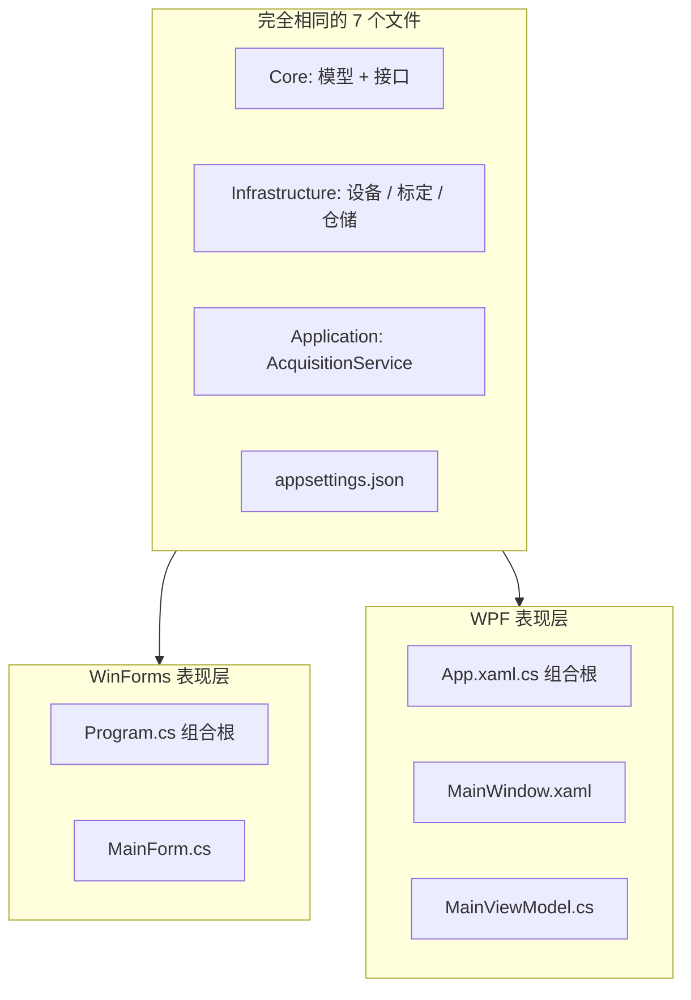

# 08 · 业务层零改动 ⭐ 第二套的核心

**目标**：能用证据说清「为什么换 UI 框架不用改业务层」，并能反推出哪些写法会破坏这件事。

## 1. 先把证据摆出来

```bash
cd Winform-WPF
for f in Core/Models.cs Core/Abstractions.cs \
         Infrastructure/SimulatedModbusClient.cs \
         Infrastructure/CalibrationService.cs \
         Infrastructure/JsonMeasurementRepository.cs \
         Application/AcquisitionService.cs appsettings.json; do
    diff "winformDemo/$f" "wpfDemo/$f" && echo "相同: $f"
done
```

七行全部输出「相同」。**领域模型、接口、设备实现、标定算法、仓储、后台采集服务、配置——逐字节一致。**



## 2. 为什么能做到：五个设计决定

| # | 决定 | 消除了什么耦合 |
|---|---|---|
| 1 | **Core 只有模型和接口**，不引用任何 UI/第三方类型 | 领域层不知道界面存在 |
| 2 | **依赖倒置**：`AcquisitionService` 依赖 `IModbusClient` 等抽象 | 换设备/数据库不影响编排 |
| 3 | **服务只发布事件** `BatchArrived`，不碰控件 | 服务不知道谁在消费、在哪个线程 |
| 4 | **用 `SynchronizationContext` 这个框架无关抽象做封送** | 两边代码一样，只是上下文实现不同 |
| 5 | **配置外部化 + 组合根集中装配** | 启动差异被限制在宿主相关的两个文件里 |

逐条验证：

```bash
grep -R "System.Windows.Forms" wpfDemo/Application wpfDemo/Core wpfDemo/Infrastructure   # 应该为空
grep -R "System.Windows"       winformDemo/Application winformDemo/Core                  # 应该为空
grep -R "SimulatedModbusClient" winformDemo/Application wpfDemo/Application              # 应该为空
```

## 3. 反事实推演：如果写成旧项目的样子会怎样

| 如果业务层里出现… | 换 WPF 时的后果 |
|---|---|
| `public static double[] data` | 状态被 UI 线程与采集线程共享，WPF 绑定拿不到变更通知，必须重写 |
| `simpleView.Invoke(...)` / `Control` 类型 | `AcquisitionService.cs` 无法在 WPF 项目里编译 |
| `Convert.ToDouble(阈值)` 在 UI 里判定 | 判定逻辑要在 WPF 里重写一遍，且容易两边不一致 |
| `SqlHelper.Insert` 写在按钮事件里 | 数据库访问要跟着 UI 一起搬 |
| `new ModbusRtuClient()` 写在页面构造函数 | 每个新界面都要重新接一次设备 |
| 8 个通道复制 8 遍 | 两边各维护一份，改一处漏一处 |

📌 所以「企业级框架」不是名词堆砌，而是**一组让变化局部化的约束**。这一章的 diff 就是这些约束的验收报告。

## 4. 逐层对照表（收好这张表）

| 关注点 | WinForms | WPF | 是否共享 |
|---|---|---|---|
| 启动装配 | `Program.Main` | `App.OnStartup` | 逻辑相同，位置不同 |
| 状态容器 | `BindingList` + 私有字段 | `ObservableObject` + `ObservableCollection` | 否 |
| 用户动作 | `Click +=` + `async void` | `IAsyncRelayCommand` | 否 |
| 界面描述 | C# `BuildUi()` | XAML | 否 |
| UI 线程封送 | `SynchronizationContext.Post` | `SynchronizationContext.Post` | **代码相同** |
| 采集循环 | `BackgroundService` | `BackgroundService` | **是** |
| 标定 / 判定 | `CalibrationService` | `CalibrationService` | **是** |
| 持久化 | `JsonMeasurementRepository` | `JsonMeasurementRepository` | **是** |
| 配置 | `appsettings.json` | `appsettings.json` | **是** |
| 关闭收尾 | `Task.Run(StopAsync)` | `Task.Run(StopAsync)` | **代码相同** |

## 5. 从「复制相同文件」到「共享类库」

现在的"零改动"是靠**复制两份**实现的，不是真正的复用。生产项目应该把共享部分抽成类库：

```
Winform-WPF.sln
├── EnterpriseDemo.Core           类库（零 UI 依赖）
├── EnterpriseDemo.Infrastructure 类库 → 引用 Core
├── EnterpriseDemo.Application    类库 → 引用 Core
├── WinformDemo.Presentation      WinExe → 引用上面三个
└── WpfDemo.Presentation          WinExe → 引用上面三个
```

改完之后：

- `diff` 不再需要，因为物理上只有一份文件；
- **编译器强制分层**：Core 类库若 `using System.Windows.Forms` 直接编译失败；
- 将来加 Web API、控制台工具、单元测试，都引用同一套业务层；
- 两个表现层项目只保留各自的组合根 + View/ViewModel。

📌 这也是第一套第 10 章「把 Core 拆成独立类库」那项任务的真正动机。学完两套后做一次，你会彻底打通。

## 🧪 动手实验

**实验 8.1 · 验证副本一致性**
跑本章第 1 节的循环 `diff`，并记录输出。然后**故意**在 `winformDemo/Core/Models.cs` 加一个空行，再跑一次，观察 `diff` 报错。做完删掉空行。这个实验说明「复制」是有维护成本的，从而理解共享类库的必要。

**实验 8.2 · 给两套同时加一个功能**
在 `ChannelReading` 里加一个 `double Deviation`（与上下限中点的偏差），在 `AcquisitionService` 里算好。然后在 `MainForm.ChannelRow` 和 `ChannelItemViewModel` 各加一列显示。观察：**业务层改动只需做一次逻辑设计，但两份副本要同步**；若已拆成共享类库，则只改一处。

**实验 8.3 · 破坏一次分层，看 WPF 会不会崩**
临时在共享的 `AcquisitionService.cs` 里加 `using System.Windows.Forms;` 和一个 `Form` 类型的局部变量，分别在两套项目 `dotnet build`。WinForms 能过，WPF 直接编译失败——这就是「框架无关」有多脆弱、又有多重要的直观证明。做完还原。

**实验 8.4 · 拆类库（毕业预演）**
新建 `EnterpriseDemo.Core` 类库项目，把 `Core/*.cs` 移过去，两个表现层项目改成 `ProjectReference`。`dotnet build` 两套，确认通过，然后删除两份旧副本。这一步做完，你就拥有了一个真正的多前端企业级解决方案。

## 自测

1. 两套项目里，`SynchronizationContext.Post` 那行代码相同，为什么两边都能正确回到各自 UI 线程？
2. 「零改动」目前是靠什么保证的？有什么隐患？
3. 把共享代码抽成类库，除了消除重复，还有什么额外收益？

<details><summary>答案要点</summary>

1. `SynchronizationContext.Current` 是抽象基类，WinForms 装 `WindowsFormsSynchronizationContext`、WPF 装 `DispatcherSynchronizationContext`；`Post` 的多态分发把委托送到各自 UI 线程。
2. 靠人工复制 + `diff` 验证；隐患是改一处忘另一处、版本漂移。
3. 编译器强制依赖方向（Core 无法引用 UI）、单一物理副本、可被更多前端与测试项目复用、可独立版本化与打包。

</details>

---

上一章：[07-XAML与界面布局](07-XAML与界面布局.md) ｜ 下一章：[09-跨线程与Dispatcher](09-跨线程与Dispatcher.md)
